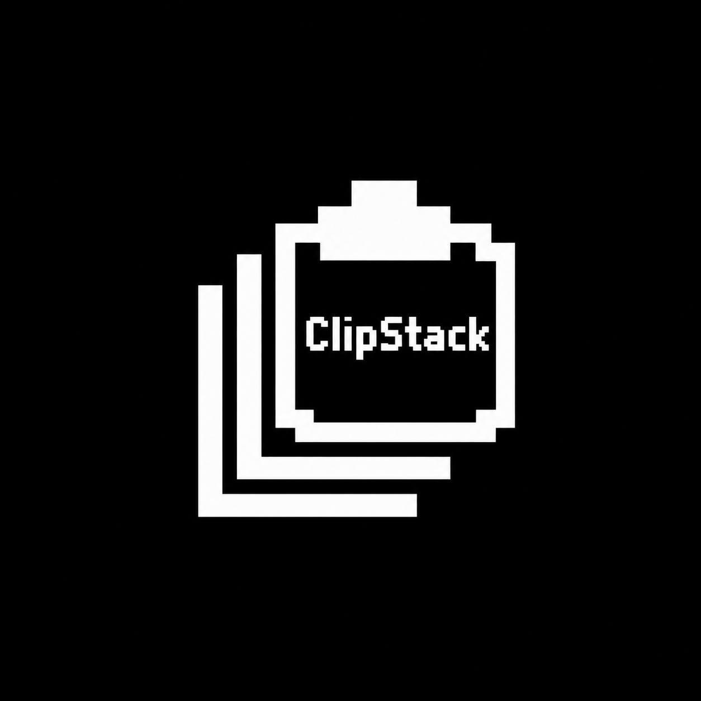

<p align="center">
  
</p>

<h1 align="center">ClipStack</h1>

<p align="center">By Jonathan Berg · <a href="https://x.com/jbtradin">@jbtradin</a></p>

ClipStack remembers the last five things you copied. Press ⌃⌥V anywhere and your screen frosts over while your recent clips slide up from the bottom. Pick one with the arrow keys and press return, and it's pasted right where you were typing. Press a number to paste that clip straight away, or esc to close. It lives quietly in your menu bar, and your clips never leave your Mac.

## Download

Get **ClipStack.dmg** from the [latest release](../../releases/latest), open it and drag ClipStack into Applications.

The first time you open it, macOS may say it can't verify the developer. Go to **System Settings → Privacy & Security** and click **Open Anyway**.

To paste for you, ClipStack needs Accessibility access. Turn it on under **System Settings → Privacy & Security → Accessibility**. You can change the shortcut from the menu bar icon under **Settings**.

## Build it yourself

```bash
./build.sh
```

Needs macOS 13+ and Xcode. The app ends up in `dist/`.
